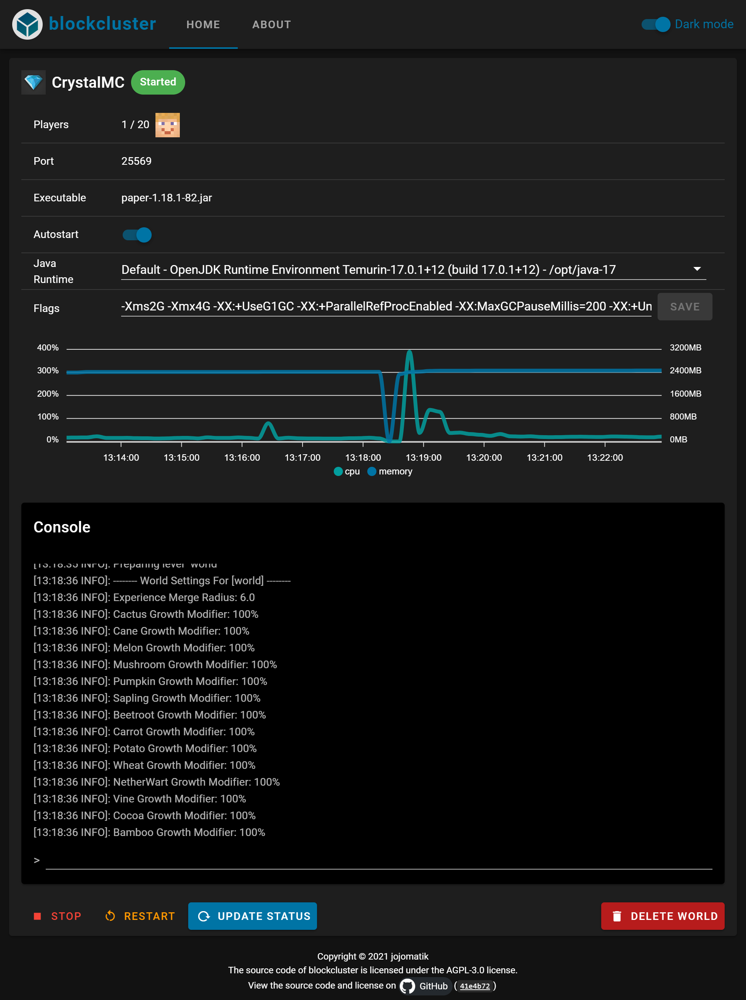

# blockcluster 
[](https://github.com/jojomatik/blockcluster/releases) [](LICENSE) [](https://github.com/jojomatik/blockcluster/actions/workflows/publish.yml) [](https://hub.docker.com/r/jojomatik/blockcluster) [](https://hub.docker.com/r/jojomatik/blockcluster)

An in-browser manager for your minecraft servers.



## Features
- Start and stop servers
- Automatically pause empty servers and unpause as soon as a client connects
- View current status and online players
- Show resource usage
- View console log and send commands
- Create servers and download server jars
- Select different java runtimes (See also: ["Adding custom java runtimes"](#adding-custom-java-runtimes))
- Change start flags
- Start servers with backend
- Show server favicon to differentiate servers easier

## Roadmap for future releases
- Authentication

## Breaking changes
blockcluster has been migrated to [Nuxt 4](https://nuxt.com) (Vue 3 and Vuetify 3). The frontend and the backend are now a single Nuxt server. If you run the docker image, the user interface changes (first two points) are the only ones that affect you.

- **Language selection:** Languages are now provided by [`@nuxtjs/i18n`](https://i18n.nuxtjs.org). The URLs do not contain a language prefix, so existing links and bookmarks keep working.
- **Look and feel:** The user interface is rendered with Vuetify 3. Components look slightly different (e.g. form fields, dialogs, tabs and the app bar) and the colors have been adjusted to the new theming system.
- **No separate backend process anymore:** There is no `backend` directory and no `npm run build_all` / `npm run serve` / `npm run start` split anymore. The application is built with `yarn build` and started with `yarn start` (`node .output/server/index.mjs`).
- **Yarn instead of npm:** The project now uses [Yarn Classic (v1)](https://classic.yarnpkg.com) as package manager. `package-lock.json` files were removed in favor of `yarn.lock`.
- **Default port of manual setups:** A manually started server listens on port `3000` by default (previously `8081`). Set the environment variable `NITRO_PORT` (or `PORT`) to change it, e.g. `NITRO_PORT=8081 yarn start`. The docker image is not affected and still listens on port `8081`. The development server (`yarn dev`) still listens on port `8081`, as the separate dev server on port `8080` and the proxy to port `3001` of the old backend have been removed.
- **No `.env` file in production:** The `.env` file is no longer loaded by the backend at runtime (`dotenv` and `dotenv-expand` were removed). Set environment variables such as `SERVER_PATH` in your environment. The `${VAR}` expansion in `.env` files is not supported anymore.
- **Relative `SERVER_PATH` and the `servers/` directory:** Relative paths are resolved against the working directory of the process (instead of the former `backend` directory). Start blockcluster from the directory that contains your `servers/` directory or use an absolute path in `SERVER_PATH`.
- **Legacy `settings.properties`:** The `server-path` property is still used as a fallback when `SERVER_PATH` is unset, but the file is read from the process working directory and this fallback is deprecated.
- **Renamed build variables:** The build-time variables `VUE_APP_GIT_SHA` and `VUE_APP_GIT_REF` were renamed to `GIT_SHA` and `GIT_REF` (relevant for custom builds, the docker build arguments `git_sha` and `git_ref` are unchanged).
- **Third party licenses:** The license notices of the libraries are generated by `rollup-plugin-license` (`/dependencies.json`) instead of `ThirdPartyNotices.txt`. The "About" page shows the production libraries included in the frontend bundle.
- **Removed and replaced libraries:** `express` and `dotenv` (backend), `vue-class-component`, `vue-property-decorator`, `vue-meta`, `vue-router` (now Nuxt's router), `vue-socket.io-extended` (now `socket.io-client` directly), `moment` (now `dayjs`), `vue-apexcharts` (now `vue3-apexcharts`), `command-exists` (unmaintained, replaced by an internal helper), and the Vue CLI toolchain with Jest (now Nuxt, Vite and Vitest).
- **Node.js:** Node.js 22.12 or newer is required for manual setups and builds.

## Setup 
### Setup with docker (recommended)
Prerequisites:
- Docker

Customize `/path/to/servers/on/host/machine` and the port directives `-p port:port` to your liking and run:
```sh
docker run -d -v /path/to/servers/on/host/machine:/usr/games/blockcluster/servers -p 8081:8081 -p 25565-25569:25565-25569 jojomatik/blockcluster:latest
```
Open `http://[your ip]:8081` in your browser.

### Setup with Docker Compose (also recommended)
Prerequisites:
- Docker
- Docker Compose

Download [`docker-compose.yml`](docker-compose.yml) and customize it to your liking and add a volume mount to your servers on the host machine. E.g.:
```
services:
  manager:
    ports:
      - 8081:8081
      - 25565:25565
    image: jojomatik/blockcluster
    volumes:
      - /path/to/servers/on/host/machine:/usr/games/blockcluster/servers
```

Then run the following command:
```sh
docker compose up
```
Open `http://[your ip]:8081` in your browser.

### Manual setup 
Prerequisites:
- Git
- Node.js (v22.12+) and [Yarn Classic](https://classic.yarnpkg.com) (v1)
- Java (to run the minecraft servers)

1. First build the app using the instructions from ["Building manually"](#building-manually).
2. Either
   - create the `servers/` subdirectory and move your servers into it or
   - set the environment variable `SERVER_PATH` to the relative or absolute path of your servers.
3. Run `NITRO_PORT=8081 yarn start` (on Windows set the environment variable `NITRO_PORT` accordingly) and open `http://[your ip]:8081` in your browser. Without `NITRO_PORT` the server listens on port `3000`.

### Adding custom java runtimes
By default, the docker image based on [`docker-compose.yml`](docker-compose.yml) and the [`Dockerfile`](Dockerfile) includes java 11, java 17, java 21 and java 25, with java 25 as the default. Those are the most relevant LTS java version for running minecraft servers (see [#150](https://github.com/jojomatik/blockcluster/issues/150) for more details).

#### Windows
All java runtimes in the `PATH` environment variable will be discovered and presented as an option in the frontend.

#### Docker
Mount additional java runtimes in the `/opt/java-xx` directory.

With the `docker run` command:
```sh
docker run -d -v /path/to/servers/on/host/machine:/usr/games/blockcluster/servers -v /path/to/java-xx/on/host/machine:/opt/java-xx -p 8081:8081 -p 25565-25569:25565-25569 jojomatik/blockcluster:latest
```
or with Docker Compose
```
services:
  manager:
    ports:
      - 8081:8081
      - 25565:25565
    image: jojomatik/blockcluster
    volumes:
      - /path/to/servers/on/host/machine:/usr/games/blockcluster/servers
      - /path/to/java-xx/on/host/machine:/opt/java-xx
```
```sh
docker compose up
```

## Building
### Building with Docker Compose (recommended)
Prerequisites:
- Git
- Docker
- Docker Compose

Run the following commands:
```sh
git clone https://github.com/jojomatik/blockcluster
cd blockcluster
```

**To build for production**, run the following command:
```sh
docker compose up
```
Open `http://[your ip]:8081` in your browser.

**To enable hot reloads**, run the following command:
```sh
docker compose -f docker-compose.yml -f docker-compose.dev.yml up
```
Open `http://[your ip]:8081` in your browser.

To make sure that the container is recreated and the image rebuilt, use either command with additional options, e.g.:
```sh
docker compose up --force-recreate --build
```

### Building manually
Prerequisites:
- Git
- Node.js (v22.12+) and [Yarn Classic](https://classic.yarnpkg.com) (v1)
- Java (only to run the minecraft servers)

Run the following commands:
```sh
git clone https://github.com/jojomatik/blockcluster
cd blockcluster
yarn install
```

**To build for production**, run the following commands (`GIT_SHA` and `GIT_REF` are only used to show the version):
```sh
GIT_SHA=$(git rev-parse HEAD) yarn build
NITRO_PORT=8081 yarn start
```
Open `http://[your ip]:8081` in your browser.

**To enable hot reloads**, run the following command (the `GIT_SHA` is used to show the version):
```sh
GIT_SHA=$(git rev-parse HEAD) yarn dev
```
Open `http://[your ip]:8081` in your browser.

### Running unit tests
Run the unit tests (frontend and backend) with Vitest:
```sh
yarn test:unit
```

## Licensing
This project is licensed under the GNU Affero General Public License v3.0 (AGPL 3.0) or later. See also [`LICENSE`](LICENSE).
